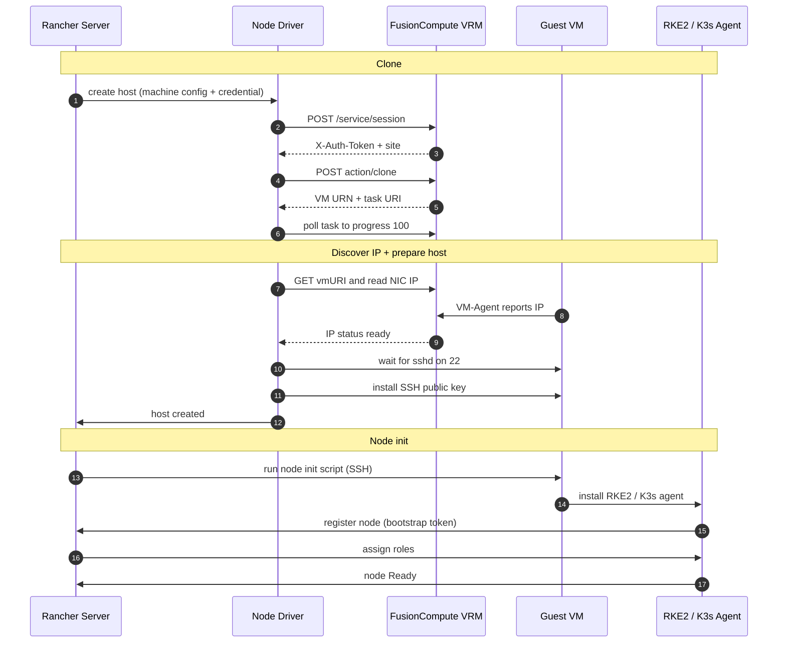

# rancher-huawei-fusioncompute-node-provider

An open-source Rancher node driver for **Huawei FusionCompute** (formerly DCS),
shipped as a monorepo with two artifacts that are built and released together:

1. **`docker-machine-driver-fusioncompute`** — a docker-machine node-driver binary.
   Rancher downloads and runs it to clone a Linux VM from a FusionCompute template,
   then SSHes in to install Docker (RKE2/K3s in Rancher). The same binary also works
   directly with `docker-machine create -d fusioncompute …`.
2. **`ui/`** — a Rancher UI extension (Vue 3, shell v3) that renders a custom
   machine-pool form and populates the Template / Datastore / Cluster / Port Group
   fields **live** from the FusionCompute API.

> **Read this first — the template matters.** The driver clones an existing
> FusionCompute **template**; it does not install an OS. If the template does not
> satisfy the [VM template requirements](#vm-template-requirements), `Create` still
> clones the VM but then fails to connect and (by default) deletes the VM.

---

## TL;DR — install the v0.2.0-beta.4 pre-release

The beta release ([v0.2.0-beta.4](https://github.com/chris-ng-1987/rancher-huawei-fusioncompute-node-provider/releases/tag/v0.2.0-beta.4))
fixes the open critical and high Dependabot alerts and publishes the linux/amd64 driver
binary and the UI bundle. The manifests in `deploy/` already point at those artifacts —
no build is needed. This is a pre-release; the stable [v0.1.0](https://github.com/chris-ng-1987/rancher-huawei-fusioncompute-node-provider/releases/tag/v0.1.0)
remains available. Prerequisites: Rancher 2.15+, a template that meets the
[VM template requirements](#vm-template-requirements), a DNS name for the VRM whose
certificate Rancher trusts, and `kubectl` access to the cluster that hosts Rancher.

```bash
# 1. Replace vrm.example.com in deploy/proxyendpoint.yaml with your VRM DNS name
#    (a bare IP cannot be allow-listed; see "Live dropdowns" below).

# 2. Register the node driver, UI extension, and proxy allow-list
kubectl --context=<rancher-local> apply -f deploy/nodedriver.yaml
kubectl --context=<rancher-local> apply -f deploy/uiplugin.yaml
kubectl --context=<rancher-local> apply -f deploy/proxyendpoint.yaml

# 3. Wait until the UI bundle is cached (the UIPlugin reports "cached")
kubectl -n cattle-ui-plugin-system get uiplugin fusioncompute -w
```

Then create a **FusionCompute** cloud credential (**Cluster Management → Cloud
Credentials**) and add a node pool with the custom machine-pool form. On arm64, change
`spec.url` in `nodedriver.yaml` to the `linux_arm64` asset and replace `spec.checksum`
with its sha256 from [`checksums.txt`](https://github.com/chris-ng-1987/rancher-huawei-fusioncompute-node-provider/releases/download/v0.2.0-beta.4/checksums.txt).
See [Deploy on Rancher](#deploy-on-rancher) for the full details.

---

## Repository layout

```
.
├── driver/                      # Go module: the docker-machine node driver
│   ├── main.go                  #   plugin entry point
│   ├── driver.go                #   Driver struct, CLI flags, validation, GetIP/GetState/…
│   ├── client.go                #   FusionCompute REST client (auth, sites, clone, tasks)
│   ├── lifecycle.go             #   Create/Remove/Start/Stop/Restart/Kill + SSH key install
│   ├── driver_test.go           #   unit tests (no live host required)
│   ├── build.sh / Makefile
│   └── go.mod / go.sum
├── ui/                          # Rancher UI extension (Vue 3)
│   ├── pkg/fusioncompute/       #   the extension package Rancher loads
│   │                            #   (Cloud Credential + machine-pool forms)
│   └── scripts/build-extension.sh
├── deploy/                      # Rancher CRs that register the driver + UI
│   ├── nodedriver.yaml          #   NodeDriver (download URL, credential fields)
│   ├── uiplugin.yaml            #   UIPlugin (delivers the custom forms)
│   ├── proxyendpoint.yaml       #   ProxyEndpoint (allow-list for the live dropdowns)
│   └── fusioncomputeconfig.yaml #   example RKE machine config
├── .github/workflows/           # CI + release pipelines
├── Makefile                     # root convenience targets
└── README.md
```

The Go module path is
`github.com/chris-ng-1987/rancher-huawei-fusioncompute-node-provider/driver`.

---

## VM template requirements

Prepare the template **before** converting it to a template in FusionCompute. The
driver clones the selected template, boots the clone, then connects as the configured
SSH user — using either the supplied private key or a one-time password — and hands the
host to docker-machine/Rancher.

1. **Linux guest with sshd on port 22.** The SSH port is hard-coded to `22` — there
   is no setting to override it.
2. **Initial access for the configured SSH user.** This is the account configured for
   the machine pool — **not necessarily root**; use whatever account the template
   provisions (e.g. `ubuntu`). Choose one of:
   - **Supply a private key (key-only).** Set `sshPrivateKey` (Rancher) or
     `--fusioncompute-ssh-private-key` (standalone) to an unencrypted private key.
     The template account's `authorized_keys` must already contain the matching public
     key. The driver writes the private key to the machine store and uses it for the
     initial login; no password is sent to FusionCompute. Key auth works under
     `PermitRootLogin prohibit-password`.
   - **Use the template's existing password once.** Supply `sshPassword` without
     `setVmPassword`: the driver logs in with that account's existing password and
     appends its generated public key. This is the default non-key flow.
   - **Reset the password on first boot.** The driver asks FusionCompute to reset the
     guest OS password. FusionCompute resets the **root** account only (the clone API
     has no username field and the reset is not permitted for other users), so the
     driver logs in as `root`. The template's sshd must then allow root password
     login:
     ```
     # /etc/ssh/sshd_config (or a drop-in under /etc/ssh/sshd_config.d/)
     PermitRootLogin yes
     PasswordAuthentication yes
     ```
     then `systemctl restart sshd`. Verify with
     `sshd -T | grep -iE 'permitrootlogin|passwordauthentication'`.
   - **Pre-bake the generated key.** Bake the driver's generated public key into the
     template account's `authorized_keys` and provision with no password.
3. **The FusionCompute VM-agent installed.** The clone sends `vmCustomization.hostname`
   and, on reset, `vmCustomization.password`; FusionCompute can only apply that
   customization if the guest has the **FusionCompute VM-agent** installed. Install
   the VM-agent in the template before converting it to a template.
4. **It must be a template (`isTemplate`).** The UI lists templates for the
   *Template* dropdown, and the driver clones from the template's VM id.
5. **Network.** The cloned NIC is attached to the chosen *Port Group* and obtains its
   address via DHCP — required for a node pool, where every VM needs its own unique
   address. The template's guest must accept DHCP on that port group.

Without a usable login the clone succeeds but the key install fails with
`ssh: unable to authenticate, attempted methods [none password]` — either the supplied
password for the configured SSH user is wrong, or (on the reset path) root password
auth is disabled (`PermitRootLogin no`/`prohibit-password`). In key-only mode the same
message means the template does not trust the supplied private key's public key for the
configured SSH user.

---

## How it works

1. Authenticates against `/service/session` with `X-Auth-User` / `X-Auth-Key`.
2. Resolves the FusionCompute site URI from `/service/sites` (or accepts a pre-resolved one).
3. POSTs a `clone` request to `{site}/vms/{template}/action/clone` with CPU, memory,
   disk, NIC, and hostname.
4. Polls the returned async task until `progress == 100` and `status == "success"`.
5. Captures the new VM's URN, then returns the guest IP that FusionCompute reports for
   the NIC (read from the VM spec at `vmConfig.nics[0].ip`) so docker-machine can SSH in.
6. Waits for sshd. In key-only mode it verifies an authenticated key handshake; in
   password mode it logs in once with the bootstrap password and installs the generated
   public key.



It also implements `Remove`, `Start`, `Stop`, `Restart`, `Kill`, and `GetState`, so the
host's lifecycle is managed with `docker-machine stop/start/rm` (and the equivalent
Rancher actions).

> The guest always obtains its address via **DHCP**: a node pool is a set of VMs, so
> each node must get its own address rather than a fixed one.

---

## Build

Requirements: **Go 1.26+** for the driver and **Node 24** for the UI.

### Driver binary only

```bash
make driver          # or: cd driver && ./build.sh
```

This produces `driver/docker-machine-driver-fusioncompute`. Put it on your `$PATH`
(the binary **must** keep the `docker-machine-driver-` prefix so `docker-machine` will
discover it):

```bash
sudo mv driver/docker-machine-driver-fusioncompute /usr/local/bin/
docker-machine create -d fusioncompute --help
```

### UI extension

```bash
make ui          # or: cd ui && corepack enable && yarn install && bash ./scripts/build-extension.sh
```

This produces `ui/dist-pkg/extensions/fusioncompute/<version>/` — a `files.txt` manifest
plus the `plugin/` bundle. Rancher's `ui-plugin-catalog` controller fetches
`<endpoint>/files.txt`, then downloads each path it lists and caches the bundle
server-side.

> The UI bundle is cached **by version**. Whenever you change the UI, bump `version` in
> **both** `ui/package.json` and `ui/pkg/fusioncompute/package.json` (and the matching
> `spec.plugin.version` + `endpoint` in `deploy/uiplugin.yaml`). Reusing a version means
> Rancher never fetches your new files.

---

## Releases

Tagging a commit with `vX.Y.Z` (stable) or `vX.Y.Z-beta.N` (pre-release) triggers
`.github/workflows/release.yml`, which:

- builds `docker-machine-driver-fusioncompute` for linux/amd64, linux/arm64,
  darwin/amd64, darwin/arm64 and windows/amd64;
- builds the UI extension bundle;
- publishes a GitHub release with the binaries, the UI bundle tarball and
  `checksums.txt`; hyphenated tags are marked as **pre-releases**;
- deploys the UI extension directory tree to **GitHub Pages**, so the `UIPlugin` CR can
  fetch `https://<owner>.github.io/<repo>/extensions/fusioncompute/<version>/files.txt`.
  Previously published version directories are restored before each deployment, so a
  new (including beta) release does not remove older endpoints.

The tag must match the version in `ui/pkg/fusioncompute/package.json`; the release
workflow fails early if they differ. Bump that file and `ui/package.json` before tagging.

> GitHub Pages must be enabled for the repository (**Settings → Pages → Build and
> deployment → Source: GitHub Actions**) before the `pages` job can publish. To host the
> UI bundle elsewhere instead, publish `ui/dist-pkg/extensions/` to any static file host
> and point the `UIPlugin` endpoint at that directory.

`.github/workflows/ci.yml` runs `go vet`, `go test`, the driver build and the UI build
on every push to `main` and on pull requests.

---

## Deploy on Rancher

### 1. Register the node driver and UI

Apply the manifests in `deploy/` against the cluster that hosts Rancher
(the `--context=<rancher-local>` in the commands below):

- `nodedriver.yaml` — the `NodeDriver` (name `fusioncompute`, the binary download URL,
  checksum, and credential-field visibility/defaults).
- `uiplugin.yaml` — the `UIPlugin` that delivers the custom machine-pool form.
- `proxyendpoint.yaml` — the allow-list for the live dropdowns (see
  [Live dropdowns](#3-live-dropdowns)).

The checked-in manifests already point at the v0.2.0-beta.4 pre-release artifacts. If you
build and publish your own, update:

- `nodedriver.yaml` → `spec.url` (the binary; use the matching OS/arch release asset).
- `uiplugin.yaml` → `spec.plugin.endpoint` (the UIPlugin **directory**, no trailing
  slash and no `component.js`) and `spec.plugin.version` (must match the built extension).

```bash
kubectl --context=<rancher-local> apply -f deploy/nodedriver.yaml
kubectl --context=<rancher-local> apply -f deploy/uiplugin.yaml
kubectl --context=<rancher-local> apply -f deploy/proxyendpoint.yaml

# Watch the UI plugin become "cached"
kubectl -n cattle-ui-plugin-system get uiplugin fusioncompute -w
```

Then, in the Rancher UI, go to **Cluster Management → Drivers → Node Drivers** and confirm
**fusioncompute** is **Active** (or add it by hand with the download URL above).

The `nodedriver.yaml` annotations matter:

- `lifecycle.cattle.io/create.node-driver-controller: "true"` — required so Rancher
  auto-creates the *instrumented* dynamic schema (the Cloud Credential form) for a
  third-party driver.
- `publicCredentialFields` / `privateCredentialFields` / `optionalCredentialFields` /
  `passwordFields` / `defaults` — control visibility and defaults for fields not covered
  by the custom UI.

`spec.uiUrl` on the `NodeDriver` is intentionally **not** set: on the Rancher 2.15
dashboard it only loads the `.css` companion for provider-tile styling, not
`component.js`. The custom form is delivered through the `UIPlugin` instead.

### 2. Cloud credential

Create a FusionCompute cloud credential (**Cluster Management → Cloud Credentials**). It
holds the VRM connection details — host/port, username, password, and an optional
pre-resolved site URI — the same inputs as the driver's connection settings (see the
[flag reference](#flag-reference)). If the host already carries an explicit port it wins
over the port setting.

The form also has a **Verify the VRM's TLS certificate** checkbox. It is off by default,
matching the driver's historical behavior and supporting self-signed VRM certificates.
Enable it when the VRM certificate chains to a CA trusted by the host running Rancher.
This option controls the Go driver's provisioning API calls only; Rancher's meta proxy
(used for the live dropdowns) always verifies the certificate.

### 3. Live dropdowns

The Template, Datastore, Cluster, and Port Group pickers are searchable selects populated
from the FusionCompute API when the form loads. The form reads the credential, logs in,
and lists templates (VMs flagged as templates), datastores, clusters, and port groups.
Each option value is exactly what the driver expects: the template's VM id, and full URNs
for the datastore, cluster, and port group.

Requests go through Rancher's **server-side** `/meta/proxy` (`$shell.proxy.request()`), so
the browser never talks to FusionCompute directly. Two things must be true or the
dropdowns come back empty (the form still renders, with a warning banner):

**a. The VRM must be allow-listed.** Rancher 2.15 authors this as `ProxyEndpoint` CRs
(`management.cattle.io/v3`, `spec.routes[].domain`). A bare IP **cannot** be allow-listed
— Rancher validates each domain against a regex whose final label must start with a
letter, so `192.0.2.50` is rejected with `should match '<regex>'`. An IP-addressed VRM
therefore needs a DNS name that resolves from the Rancher server; put that name in both
the `ProxyEndpoint` and the credential's host. Earlier Rancher releases used node-driver
allow-lists / the global `whitelist-domains` setting, so keep the VRM in
`nodedriver.yaml`'s `whitelistDomains` as well if you must support both.

**b. Rancher must trust the VRM's TLS certificate (and the cert must name the host you
dial).** Rancher's proxy always verifies the upstream certificate and has no skip-verify
option, even if the credential's `verifyTls` option is off for the Go driver. A factory
VRM serves a self-signed certificate whose CN/SAN are the generated `vrmcaserver<hex>`
name, so a ProxyEndpoint request fails first on trust and then on
`no alternative certificate subject name matches target hostname`.

Fix this either by re-issuing the VRM certificate with `DNS:<name>` in its SAN, or by
putting a TLS-terminating reverse proxy in front of the VRM that presents a certificate
for a DNS name you control and forwards to the VRM with verification off. Trust that
certificate's CA in Rancher, point a DNS name at the proxy, and use that name as the
credential's host. (A self-contained nginx reverse-proxy setup is a common way to do
this; it is intentionally out of scope for this repository.)

> Diagnosing failures: allow-list denial and an upstream/TLS failure both surface to the
> browser as a failed request. Rancher's server log distinguishes them —
> `Failed to proxy: invalid host: <host>` = not allow-listed;
> `http: proxy error: x509: certificate signed by unknown authority` = TLS trust failure.

### 4. The machine-pool form

The UI extension renders the machine pool in sections:

- **Machine** — vCPU, memory, and system-disk size (unit-aware numeric inputs).
- **Placement** — Template, Datastore, and Cluster (live selects).
- **Network** — Port Group (the guest obtains its address via DHCP).
- **Access** — choose **Authentication**:
  1. **SSH private key** → paste an unencrypted private key. The driver writes it to the
     machine store (`id_rsa`, mode `0600`), derives the matching public key, and uses it
     for the initial login. The template must already trust that public key for the SSH
     user; no password is sent to FusionCompute. Mutually exclusive with the
     password/reset options and with `sshKeyPath`.
  2. **Username and password**, reset off → the SSH user and the template's *existing*
     password for that account (use the template's own user — **not necessarily root**)
     are used once to install the driver's generated key; leave the password blank if the
     template already trusts the key.
  3. **Username and password**, reset on, generate → the driver generates a random
     password (stored on the node); no password field is shown.
  4. **Username and password**, reset on, no generate → the value entered is the *new*
     password FusionCompute resets on first boot.
- **Advanced** — the remaining driver settings via the generic `<Questions>` renderer.

When a password reset is on, the SSH user is hidden: FusionCompute resets **root** and the
driver logs in as root for the key install and later logins. SSH port and key path are
hidden (SSH is always 22 and a path-based key is for standalone docker-machine); the
**SSH private key** authentication mode is the Rancher-native key-only option.

`deploy/fusioncomputeconfig.yaml` is a ready-to-edit example `FusioncomputeConfig`.

---

## Use with `docker-machine` (standalone)

The same binary works without Rancher:

```bash
docker-machine create -d fusioncompute \
  --fusioncompute-dcs-hostname="vrm.example.com" \
  --fusioncompute-dcs-port="7443" \
  --fusioncompute-dcs-username="admin" \
  --fusioncompute-dcs-password="$DCS_PASSWORD" \
  --fusioncompute-dcs-site-uri="/service/sites/1" \
  --fusioncompute-template-id="i-00000001" \
  --fusioncompute-cpu=4 \
  --fusioncompute-memory-mb=8192 \
  --fusioncompute-disk-gb=250 \
  --fusioncompute-port-group-urn="urn:sites:1:dvswitchs:1:portgroups:1" \
  --fusioncompute-datastore-urn="urn:sites:1:datastores:1" \
  --fusioncompute-location="urn:sites:1:clusters:1" \
  --fusioncompute-generate-password=true \
  --fusioncompute-ssh-user=root \
  my-node-01
```

`--fusioncompute-dcs-hostname` may also embed the port (`vrm.example.com:7443`), in which
case `--fusioncompute-dcs-port` is ignored.

For access to the new guest, choose one mode:

- `--fusioncompute-ssh-private-key="$FUSIONCOMPUTE_SSH_PRIVATE_KEY"` — key-only access.
  Pass the unencrypted private key contents (prefer the environment variable over a
  command-line argument so the key doesn't land in shell history or the process list).
  The driver writes it to `<machine>/id_rsa` (mode `0600`), derives `id_rsa.pub`, and
  uses the key for the initial login. The template must already trust the matching public
  key for `--fusioncompute-ssh-user`; no password is sent to FusionCompute. Mutually
  exclusive with the password/reset options and `--fusioncompute-ssh-key-path`.
- `--fusioncompute-generate-password=true` — the driver generates a random root password,
  resets it on first boot via FusionCompute's guest customization
  (`vmCustomization.password` + `isUpdateVmPassword=true`), persists it at
  `<machine>/fusioncompute-generated-password` (mode `0600`), and then installs
  `id_rsa.pub` using it; or
- `--fusioncompute-ssh-password` with `--fusioncompute-set-vm-password` — the same flow
  with an operator-chosen password. Setting `--fusioncompute-set-vm-password` with no
  password also auto-generates one, so a blank password is never sent.

The password flows require the template to support FusionCompute guest customization.
With none of the options above, the template must already trust the generated
`id_rsa.pub`. Private keys must be unencrypted: libmachine cannot prompt for or decrypt a
passphrase-protected key.

The reset always targets the **root** account. FusionCompute's `vmCustomization` has no
username field, and its `changePassword` action is only permitted for root on Linux, so
when a reset is requested the driver forces `--fusioncompute-ssh-user=root`.

If `Create` fails after the clone (e.g. the key install times out), the driver deletes the
VM so a failed create does not leave an orphan in FusionCompute. Set
`--fusioncompute-keep-failed-vm=true` to keep it for debugging.

Every flag also accepts an environment variable (see the table below).

---

## Flag reference

| Flag                                  | Env var                       | Required | Description                                  |
|---------------------------------------|-------------------------------|----------|----------------------------------------------|
| `--fusioncompute-dcs-hostname`        | `FUSIONCOMPUTE_DCS_HOSTNAME`  | yes      | FusionCompute API host (may include `:port`) |
| `--fusioncompute-dcs-port`            | `FUSIONCOMPUTE_DCS_PORT`      | no       | API TCP port (default `7443`; ignored when hostname already includes `:port`) |
| `--fusioncompute-dcs-username`        | `FUSIONCOMPUTE_DCS_USERNAME`  | yes      | `X-Auth-User`                                |
| `--fusioncompute-dcs-password`        | `FUSIONCOMPUTE_DCS_PASSWORD`  | yes      | `X-Auth-Key`                                 |
| `--fusioncompute-dcs-site-uri`        | `FUSIONCOMPUTE_DCS_SITE_URI`  | no       | Skip sites query if you already know it      |
| `--fusioncompute-verify-tls`          | `FUSIONCOMPUTE_VERIFY_TLS`    | no       | Verify the VRM's TLS certificate (default `false`: skip verification for self-signed certificates) |
| `--fusioncompute-template-id`         | `FUSIONCOMPUTE_TEMPLATE_ID`   | yes      | Template (or source VM) ID to clone from     |
| `--fusioncompute-cpu`                 | `FUSIONCOMPUTE_CPU`           | no       | vCPU count (default `2`)                     |
| `--fusioncompute-memory-mb`           | `FUSIONCOMPUTE_MEMORY_MB`     | no       | RAM in MB (default `4096`)                   |
| `--fusioncompute-disk-gb`             | `FUSIONCOMPUTE_DISK_GB`       | no       | Boot disk in GB (default `250`)              |
| `--fusioncompute-port-group-urn`      | `FUSIONCOMPUTE_PORT_GROUP_URN`| yes      | NIC port-group URN                           |
| `--fusioncompute-datastore-urn`       | `FUSIONCOMPUTE_DATASTORE_URN` | yes      | Destination datastore URN                    |
| `--fusioncompute-location`            | `FUSIONCOMPUTE_LOCATION`      | no       | FusionCompute location (cluster) URN         |
| `--fusioncompute-vm-description`      | `FUSIONCOMPUTE_VM_DESCRIPTION`| no       | Description string for the new VM            |
| `--fusioncompute-ssh-user`            | `FUSIONCOMPUTE_SSH_USER`      | no       | OS user docker-machine SSHes in as (default `root`) |
| `--fusioncompute-ssh-private-key`     | `FUSIONCOMPUTE_SSH_PRIVATE_KEY`| no      | Unencrypted private key contents for key-only initial access; template must already trust the matching public key. Mutually exclusive with the password/reset and key-path options |
| `--fusioncompute-ssh-key-path`        | `FUSIONCOMPUTE_SSH_KEY_PATH`  | no       | Path to a pre-provisioned private key on the host running the driver; template must already trust the matching public key. Mutually exclusive with `--fusioncompute-ssh-private-key` |
| `--fusioncompute-ssh-password`        | `FUSIONCOMPUTE_SSH_PASSWORD`  | no       | Guest password: the template's existing credential, or the new one to reset with `--fusioncompute-set-vm-password`. Used only as a one-time bootstrap to install the SSH key |
| `--fusioncompute-set-vm-password`     | `FUSIONCOMPUTE_SET_VM_PASSWORD`| no      | Send `isUpdateVmPassword=true` so FC applies the password on first boot |
| `--fusioncompute-generate-password`   | `FUSIONCOMPUTE_GENERATE_PASSWORD`| no    | Generate a random guest password, reset it on clone, and store it at `<machine>/fusioncompute-generated-password` (overrides `--fusioncompute-ssh-password`) |
| `--fusioncompute-keep-failed-vm`      | `FUSIONCOMPUTE_KEEP_FAILED_VM`| no       | Keep the cloned VM if provisioning fails after the clone (default: delete it to avoid orphans) |

> The SSH port is fixed at `22` — FusionCompute templates provisioned by this driver always
> run sshd on 22, so there is no flag to override it.

> In Rancher, `sshPrivateKey` is part of the `FusioncomputeConfig` machine config. The UI
> masks it and the driver clears it from its own state after writing `<machine>/id_rsa`,
> but the CR itself still contains the key — treat it as sensitive and restrict RBAC
> accordingly. For a shared operator-managed key, prefer `sshKeyPath` with the private key
> mounted into the Rancher container and its public key baked into the template.

---

## Limitations

- Single NIC, single boot disk. Extend `buildCloneSpec` if you need more.
- TLS verification is skipped by the Go driver. Rancher's server-side proxy does **not**
  skip verification — see [live dropdowns](#3-live-dropdowns).
- The driver assumes FusionCompute API version `v8.1`. Adjust `fcAPIVersion` in
  `driver/client.go` for other versions.

---

## Contributing

Pull requests are welcome. Before opening one, run:

```bash
make vet test     # driver: go vet + go test
make driver       # driver: build
make ui           # UI: build the extension bundle (needs Node 24)
```

CI runs the same checks.

## License

Apache License 2.0 — see [LICENSE](LICENSE).

FusionCompute is a trademark of Huawei Technologies Co., Ltd. This project is an
independent, community-maintained integration and is not affiliated with or endorsed by
Huawei or SUSE/Rancher.
